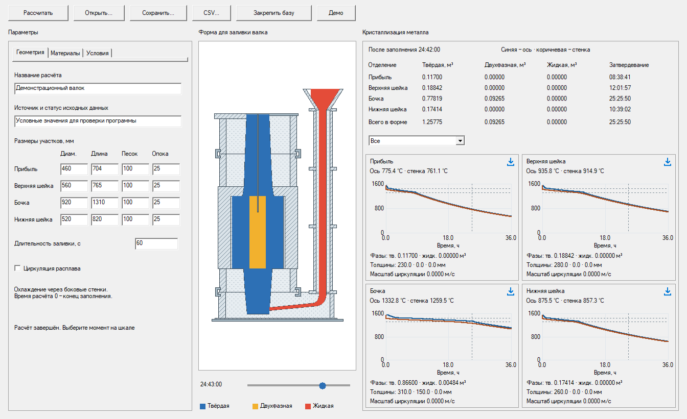

# Проверка восьмого этапа RollCast

## Объём этапа

Управление расчётным проектом и воспроизведение заливки: три вкладки параметров, фоновое вычисление, сводка трёх геометрических зон, выбор графиков, временная шкала, форматы .roll и CSV, PNG, постоянная база сравнения.

## Причина задержек

В седьмом этапе движение мыши вызывало перерисовку всего окна. Четыре температурных графика строились по всем 4321 отсчётам, что требовало примерно 17284 вызовов LineTo за кадр. Графический буфер и области деталей формы создавались заново. Расчёт выполнялся в оконном потоке и задерживал обработку событий.

Теперь наведение обновляет только форму, её геометрические области сохраняются до изменения размеров, растровый буфер переиспользуется. Для каждого экранного столбца температурной кривой сохраняются минимальная, максимальная и последняя точки в исходном временном порядке. Подготовленная линия выводится одним вызовом Polyline. Полные отсчёты сохраняются в расчётной истории и CSV. Вычисление выполняется через отменяемый std::jthread, а оконный поток получает только готовый результат.

## Измерение отрисовки

Локальная проверка выполнена 20 ноября 2026 года в Windows. Сравнивались исходники седьмого этапа из коммита 1e2c1a2 и текущая сборка, обе с оптимизацией компилятора. Размер окна составлял 1360 × 860, проект демонстрационный, четыре графика по 4321 отсчёту. После прогрева выполнялись 100 перемещений мыши между точками формы и 100 изменений положения ползунка. Время включает отправку сообщения и синхронное завершение перерисовки.

| Действие | Седьмой этап, среднее | Восьмой этап, среднее | Седьмой этап, максимум | Восьмой этап, максимум |
| --- | ---: | ---: | ---: | ---: |
| Наведение | 421,06 мс | 2,54 мс | 1962,35 мс | 19,31 мс |
| Изменение кадра | 470,95 мс | 9,58 мс | 2201,90 мс | 27,05 мс |

Это локальный замер времени обработчиков и рисования, а не гарантия частоты кадров на любом оборудовании. На результат влияют состояние Windows, графическая подсистема и размер окна. Время теплового расчёта измерением отрисовки не оценивается.

## Проверки ядра и файлов

Сборка Release завершена успешно. Синтаксическая проверка всех исходников и тестов с -Wall -Wextra -Wpedantic -Werror прошла без предупреждений. CTest выполняет два набора: cylinder_cooling и project_workflow, оба прошли.

Сохранены прежние проверки аналитического цилиндра, энергетического баланса, теплоизоляции, фазовых объёмов, циркуляции и четырёх отделений. Новый набор независимо проверяет сохранение каждого параметра .roll, русские имена файлов, конечный неполный шаг времени, чтение при наличии итоговой сводки, отказ для обрезанного файла, число строк и столбцов CSV, начало его времени после заполнения, балансы трёх зон и двух фаз, оценку плотности с сохранением массы. Проверены влияние контактного сопротивления, энергетический баланс на контакте, наличие профиля, постоянный расход наглядной заливки, отмена задания с сохранением старого результата и отказ для неопределённого коэффициента.

## Проверки интерфейса

В настоящем окне Windows проверены развёрнутый запуск, минимальный размер 1240 × 800, три вкладки параметров, пять вариантов выбора графиков, видимость соответствующих иконок, кадры пустой формы, литникового пути, частичного заполнения и охлаждения. Подтверждены круглое оформление шкалы, расположение времени и легенды под формой. Графики выгружены через системный диалог в PNG; .roll сохранён и вновь открыт через интерфейс; CSV выгружен полностью. Проверены пересчёт после изменения размера, запрет устаревшего экспорта, закрепление базы, её восстановление после перезапуска, снятие закрепления, Enter, некорректное числовое поле и возврат демонстрации.

## Границы результата

Заливка является наглядным сценарием, а тепловая задача начинается после полного заполнения. Движение свободной поверхности и охлаждение поступающего металла не решаются. Плотность твёрдой фазы включает только отдельную оценку в CSV, без питания усадки и изменения геометрии. Поля контактов используют специальное соглашение: ноль означает идеальное сопряжение, положительное значение задаёт конечное сопротивление. Ноль наружной теплоотдачи означает теплоизоляцию.

Закреплённая база хранит исходные данные и восстанавливает расчёт текущей версией алгоритма. Архивная полная история сохраняется отдельно в CSV. Подробности модели, форматов и единиц приведены в README.
